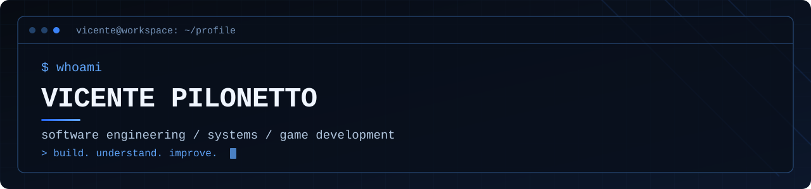
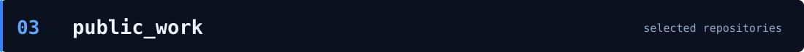
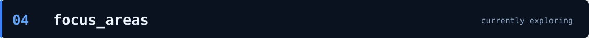
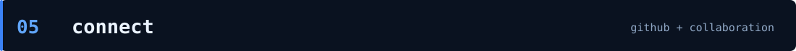

<div align="center">
  
  <p><strong>Software Developer &nbsp;·&nbsp; Systems Enthusiast &nbsp;·&nbsp; Game Development</strong></p>
  <p>
    
    
    
    
    
    
  </p>
</div>


I'm **Vicente Pilonetto**, a software developer interested in understanding how technology works, from the user interface down to the operating system.

I build and explore **native applications, automation tools, database utilities, Linux environments and game systems**. I value maintainable software, practical solutions and learning through real projects.

```text
$ cat ~/profile.conf

role       = software developer
focus      = native applications / systems / developer tooling
languages  = C++ / Python / SQL / C / C#
interests  = Linux / databases / game development / self-hosting
method     = understand > design > build > test > improve
```


### Languages & scripting


| Technology | Practical focus |
| :--- | :--- |
| **C / C++** | Systems, native utilities, file processing and Godot gameplay code. |
| **Python** | Automation, backends and developer tools. |
| **SQL** | Data analysis, queries, diagnostics and database maintenance. |
| **C#** | Application programming and .NET exploration. |
| **Bash / PowerShell** | Setup, troubleshooting and repeatable workflows. |

### Desktop, web & game development


- **Qt / PySide6:** desktop GUI and productivity applications.
- **Godot 4 / C++ GDExtension:** 2D game logic, animation, movement and interaction architecture.
- **FastAPI / WebSockets:** APIs and real-time backend services.
- **React / Vite / HTML / CSS / JavaScript:** frontend development and experimentation.
- **Unity:** additional game-engine learning, rather than a current primary stack.

### Data & storage


Firebird troubleshooting and administration; relational data with PostgreSQL and SQLite; XML/JSON for integrations, parsing and validation.

### Linux, infrastructure & tooling


| Domain | Tools / interests |
| :--- | :--- |
| **Operating systems** | Arch Linux, Debian, Ubuntu, Windows, Linux From Scratch. |
| **Containers & virtualization** | Docker, Podman, Proxmox VE. |
| **Network & remote access** | SSH, Tailscale and self-hosting. |
| **Build & development** | Git, GitHub, GCC, G++, CMake, debugging and Linux tooling. |



### [01 / Harpia Linux](https://github.com/Vicente-PIlonetto/harpia-linux)

**Experimental Linux distribution** · `Linux From Scratch` · `Bash` · `GCC` · `systemd`

A Linux distribution experiment assembled incrementally from source, focused on modularity, system internals and future Server / Desktop editions. **In development; not a production-ready release.**

### [02 / VyChat](https://github.com/Vicente-PIlonetto/Vicente-PIlonetto-Vychats-trabalho-finall-POO-II)

**Self-hosted chat application** · `Python` · `FastAPI` · `WebSockets` · `SQLite`

A full-stack chat project with real-time communication, direct messages, file attachments and a launcher for managing its backend.

### [03 / GUINAPP](https://github.com/Vicente-PIlonetto/Guiapp)

**Modular technical file-analysis platform** · `React` · `Vite` · `FastAPI` · `C` · `Firebird`

A developer-oriented application for validating and processing technical files using a React interface, Python APIs and native tooling.

<sub>Only publicly available repositories are highlighted here. Descriptions refer to documented features and project direction; unfinished components are not presented as shipped products.</sub>



```text
[01] Native applications and systems programming
[02] Linux internals and environment customization
[03] Databases, diagnostics and automation
[04] Game systems with Godot and C++
[05] Self-hosted services and networked applications
[06] Testing, developer experience and maintainability
```



I'm always interested in useful tools, elegant engineering and projects that make technology easier to understand.

**[Explore my public repositories](https://github.com/Vicente-PIlonetto?tab=repositories)**

---

<div align="center"><sub><code>vicente@workspace:~$ build && test && improve</code></sub></div>
