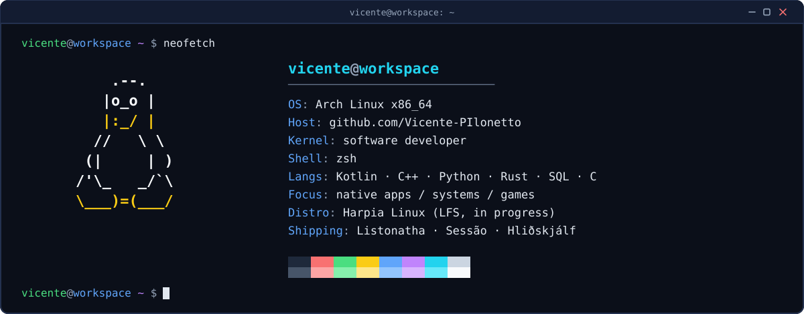
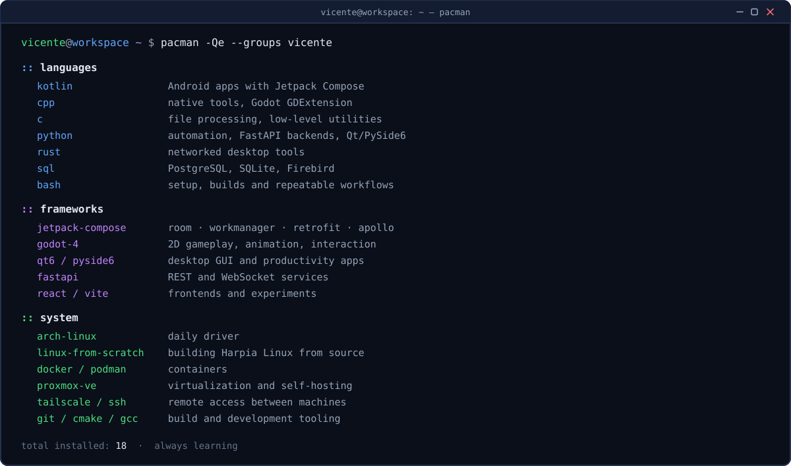
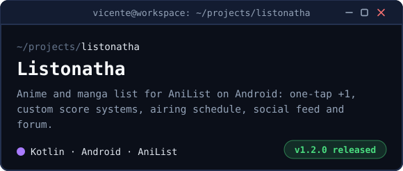
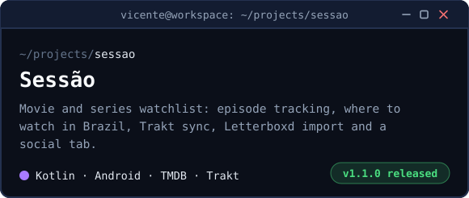
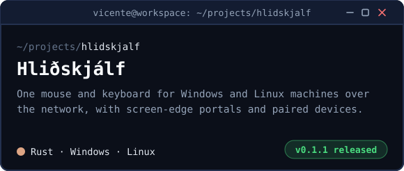
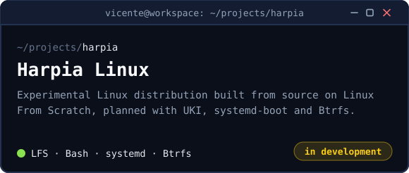
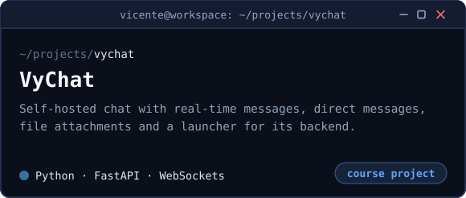
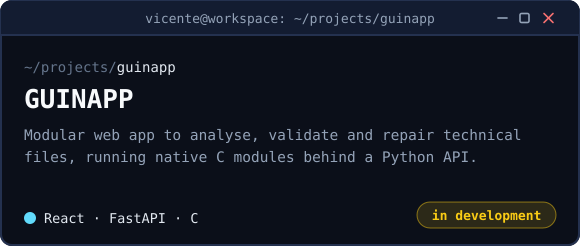
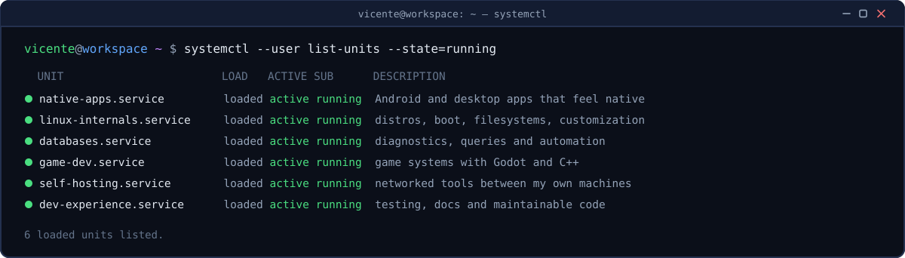
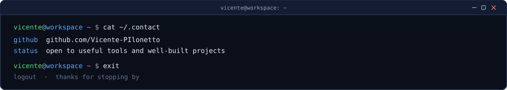

<div align="center">
  
</div>


I'm **Vicente Pilonetto**, a software developer who likes to understand how things work, from the interface down to the operating system.

These days I build **Android apps in Kotlin**, **native and networked tools**, and a **Linux distribution from source**. I care about software that is fast, honest about what it does and easy to maintain, and I learn by shipping real projects.

```text
$ cat ~/.config/profile.conf
role      = software developer
focus     = native apps / systems / developer tooling
languages = Kotlin / C++ / Python / Rust / SQL / C
method    = understand > design > build > test > improve
```





<table>
  <tr>
    <td width="50%"><a href="https://github.com/Vicente-PIlonetto/Listonatha"></a></td>
    <td width="50%"><a href="https://github.com/Vicente-PIlonetto/SessaoMovies"></a></td>
  </tr>
  <tr>
    <td width="50%"><a href="https://github.com/Vicente-PIlonetto/Hlidskjalf"></a></td>
    <td width="50%"><a href="https://github.com/Vicente-PIlonetto/harpia-linux"></a></td>
  </tr>
  <tr>
    <td width="50%"><a href="https://github.com/Vicente-PIlonetto/Vicente-PIlonetto-Vychats-trabalho-finall-POO-II"></a></td>
    <td width="50%"><a href="https://github.com/Vicente-PIlonetto/Guiapp"></a></td>
  </tr>
</table>

<sub>Only public repositories are listed. Projects marked "in development" are not finished products.</sub>







<div align="center">

**[Explore my public repositories](https://github.com/Vicente-PIlonetto?tab=repositories)**

</div>
